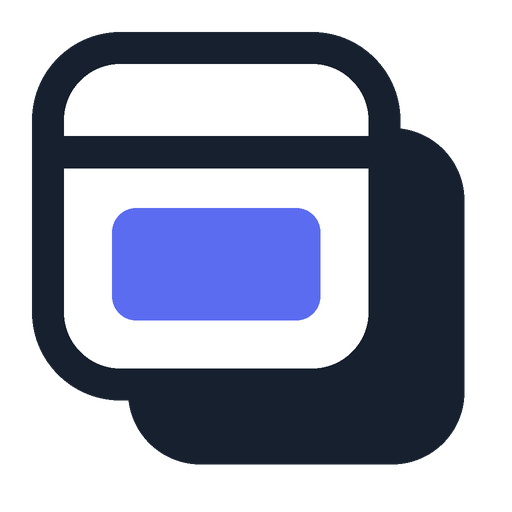
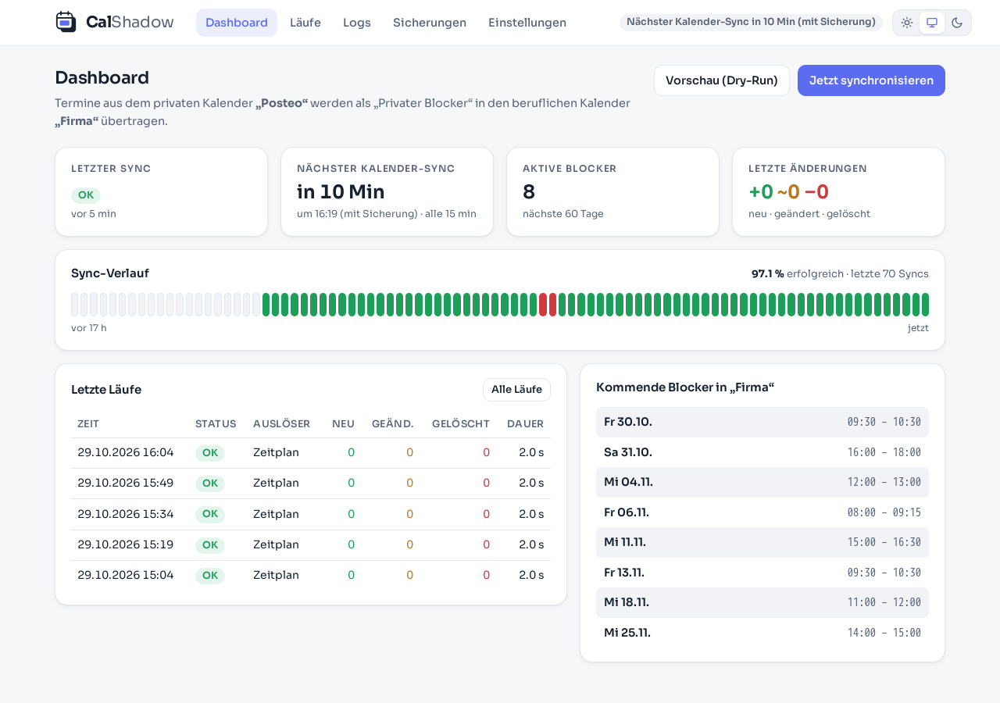
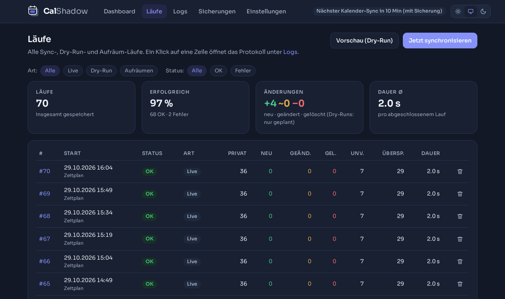
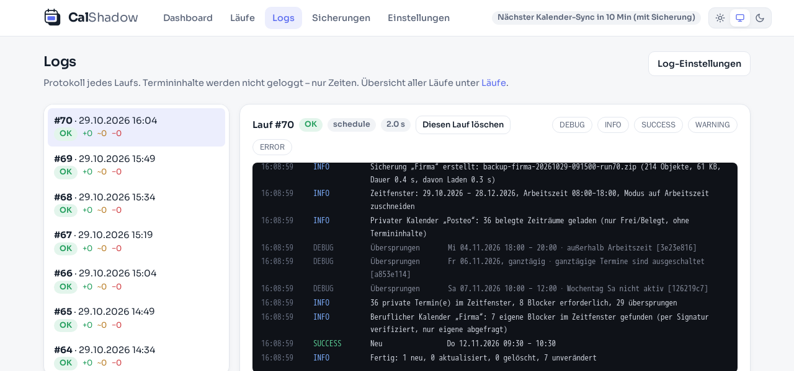

<p align="center">
  
</p>

<h1 align="center">CalShadow</h1>

<p align="center">
  <strong>Private Termine als anonyme Blocker im Arbeitskalender – ohne private Inhalte.</strong><br>
  <a href="https://github.com/Antrilas/calshadow/actions/workflows/tests.yml"></a>
  <a href="LICENSE"></a>
</p>

CalShadow überträgt die Termine aus deinem **privaten Kalender** (z. B. Posteo) als „Privater Blocker“ in deinen
**beruflichen Kalender** (z. B. SOGo). Kolleginnen und Kollegen sehen, wann du belegt bist, und planen nicht in
deinen Zahnarzttermin hinein – aber sie sehen nie, *was* du vorhast.



## Funktionen

- **Einweg-Sync per CalDAV** vom privaten in den beruflichen Kalender, z. B. alle 15 Minuten
- **Keine Inhalte**: Blocker haben einen festen Titel und eine optionale feste Beschreibung – nie Titel, Ort,
  Beschreibung oder Teilnehmer des privaten Termins
- **Frei/Belegt-Modus**: Der private Server liefert nur „belegt von–bis“, CalShadow sieht die Inhalte gar nicht erst
- **Regeln**: Zeitraum (Tage zurück/voraus), Arbeitszeit (komplett innerhalb oder zuschneiden), Wochentage,
  ganztägige, „freie“ und vorläufige Termine
- Serientermine werden zu Einzelterminen; gelöschte oder verschobene private Termine werden nachgezogen
- **Sicherungen** des beruflichen Kalenders vor dem Sync, mit Aufbewahrungsregeln, Download und manuellen Sicherungen
- **Weboberfläche** mit Dashboard, Sync-Verlauf, Läufen, Logs, Dry-Run-Vorschau, Test-Blocker und „Aufräumen“
  (alle Blocker entfernen), hell/dunkel
- **Monitoring** über Healthcheck, eine API für [Homepage](https://gethomepage.dev) und Pushes an
  [Uptime Kuma](https://github.com/louislam/uptime-kuma)

<table>
  <tr>
    <td></td>
    <td></td>
  </tr>
</table>

## Schnellstart

Voraussetzung: Docker mit Compose. Images gibt es für `linux/amd64` und `linux/arm64`.

```bash
mkdir calshadow && cd calshadow
curl -fsSLO https://raw.githubusercontent.com/Antrilas/calshadow/main/deploy/compose.yaml
echo "WEB_PASSWORD=$(openssl rand -base64 18)" > .env && chmod 600 .env
mkdir -p data && sudo chown 1000:1000 data
docker compose up -d
```

Dann `http://<host>:8080` öffnen (Benutzer `admin`, Passwort aus `.env`) und unter **Einstellungen**:

1. **Privater Kalender**: Server (Posteo: `https://posteo.de:8443/`), Benutzername, Passwort →
   „Verbindung testen“ → Kalender übernehmen. Abfrageart **Nur Frei/Belegt** wählen, wenn der Server es unterstützt.
2. **Beruflicher Kalender**: Server (SOGo: `https://<host>/SOGo/dav/`), Benutzername, Passwort →
   „Verbindung testen“ → persönlichen Kalender übernehmen. Mit **Test-Blocker anlegen** lässt sich der Schreibzugriff prüfen.
3. **Speichern**, auf dem Dashboard **Vorschau (Dry-Run)** ausführen und das Ergebnis unter *Logs* prüfen.
4. Unter **Sync-Zeitplan** den automatischen Sync einschalten.

Images: `ghcr.io/antrilas/calshadow` und `antrilas/calshadow` (Docker Hub). Update: Version in `compose.yaml`
erhöhen, dann `docker compose pull && docker compose up -d`.

### Aus dem Quellcode

```bash
git clone https://github.com/Antrilas/calshadow.git && cd calshadow
echo "WEB_PASSWORD=$(openssl rand -base64 18)" > .env
docker compose up -d --build
```

## Datenschutz und Sicherheit

**Privater Kalender: nur lesend.** Der Zugang zum privaten Kalender lässt ausschließlich `GET`, `HEAD`, `OPTIONS`,
`PROPFIND` und `REPORT` zu – doppelt abgesichert im CalDAV-Client und in der HTTP-Session. Jede schreibende Anfrage
wird vor dem Versand blockiert. Liegt der berufliche Kalender versehentlich auf dem Server des privaten, bricht der Sync ab.

**Frei/Belegt statt Inhalte.** Mit der Abfrageart *Nur Frei/Belegt* (CalDAV `free-busy-query`) liefert der private
Server nur belegte Zeiträume. „Frei“ markierte Termine lässt er selbst weg, ganztägige erkennt CalShadow an
Mitternacht–Mitternacht (lokal oder UTC). Mit *Termine lesen* werden komplette Termine abgerufen, aber nicht gespeichert.

**Beruflicher Kalender: nur eigene Blocker.** Ein Termin gilt nur dann als eigener Blocker, wenn alles zutrifft:

1. UID im Format `calshadow-<40 Hex-Zeichen>`
2. Eigenschaft `X-CALSHADOW` mit einer HMAC-SHA256-Signatur der UID, erzeugt mit dem geheimen Schlüssel dieser Installation
3. genau ein Termin, keine Serie, keine Teilnehmer, feste Start- und Endzeit

Der Titel spielt für die Erkennung keine Rolle. Zusätzlich:

- Schreiben (`PUT`/`DELETE`) ist nur auf einzeln freigegebene Termine im Zielkalender erlaubt.
- Vor jedem Ändern oder Löschen wird der Termin frisch geladen, erneut geprüft und nur mit passendem ETag geschrieben.
- Neue Blocker werden mit `If-None-Match: *` angelegt und überschreiben nie etwas.
- Standardmäßig fragt CalShadow per serverseitigem UID-Filter nur die eigenen Blocker ab – Termine von dir und
  Kollegen werden beim Sync nicht gelesen (abschaltbar, falls ein Server den Filter nicht unterstützt).
- Sicherheitsstopp: Mehr als 30 Löschungen in einem Lauf (einstellbar) brechen den Lauf ab.

**Weboberfläche.** Anmeldung per HTTP Basic Auth (`WEB_USER`/`WEB_PASSWORD`). Passwortfelder sind gegen automatisches
Ausfüllen durch Passwort-Manager geschützt. Termintitel erscheinen in Logs nur mit einer ausdrücklich aktivierten
Debug-Option und nie in den Docker-Logs.

**Daten.** Einstellungen inklusive CalDAV-Passwörtern, Logs und der Signaturschlüssel liegen in `data/calshadow.db`,
Sicherungen in `data/backups/`. Das Verzeichnis entsprechend schützen. Wenn dein Kalenderanbieter App-Passwörter
anbietet, nutze eines. Geht die Datenbank verloren, erkennt CalShadow alte Blocker nicht mehr – dann bleiben sie
liegen und müssen von Hand entfernt werden.

Sicherheitslücken bitte vertraulich melden, siehe [SECURITY.md](SECURITY.md).

## Sicherungen

Vor einem Sync wird der komplette berufliche Kalender (Termine und Aufgaben) als ZIP gesichert – höchstens einmal
pro einstellbarem Abstand (Standard 60 Minuten). Schlägt die Sicherung fehl, wird nichts geändert.
Aufbewahrung (einstellbar): die letzten 10, je eine pro Stunde für 72 Stunden (ohne Wochenende) und je eine pro Tag
für 28 Tage. Manuelle Sicherungen beider Kalender bleiben, bis sie gelöscht werden.
Wiederherstellen: `kalender.ics` aus dem ZIP im Kalender importieren; einzelne Termine liegen unverändert unter `objects/`.

## Monitoring

| Adresse | Anmeldung | Zweck |
|---|---|---|
| `/healthz` | keine | `200`, wenn Datenbank und Zeitplan laufen, sonst `503`; nutzt auch der Docker-Healthcheck |
| `/api/homepage` | Header `X-API-Key: <Lese-Token>` | Status (`OK`, `Läuft`, `Fehler`, `Veraltet`, `Deaktiviert`, `Nicht eingerichtet`), letzter und nächster Sync, Anzahl Blocker |
| Push an Uptime Kuma | – | nach jeder automatischen Sicherung (optional auch jedem Sync): `up` mit Dauer als Ping bzw. `down` mit Fehlermeldung |

Lese-Token und Push-URLs stehen unter **Einstellungen → Monitoring**.

<details>
<summary><strong>Homepage einrichten</strong></summary>

CalShadow und Homepage in ein gemeinsames Docker-Netzwerk hängen (z. B. `docker network create monitoring`, in beiden
Compose-Dateien als `external` eintragen). Den Token in Homepages Compose als Umgebungsvariable
`HOMEPAGE_VAR_CALSHADOW_TOKEN` übergeben, dann in `config/services.yaml`:

```yaml
- Privat:
    - CalShadow:
        icon: http://<host>:8080/static/brand/icon-512.png
        href: http://<host>:8080
        description: Private Termine → Arbeitskalender
        server: my-docker          # optional: Container-Status über den Docker-Socket
        container: calshadow
        siteMonitor: http://calshadow:8080/healthz
        widget:
          type: customapi
          url: http://calshadow:8080/api/homepage
          refreshInterval: 60000
          headers:
            X-API-Key: "{{HOMEPAGE_VAR_CALSHADOW_TOKEN}}"
          mappings:
            - field: status
              label: Status
            - field: last_sync
              label: Letzter Sync
              format: relativeDate
            - field: blockers
              label: Blocker
              format: number
```

`icon` und `href` lädt der Browser (also die Adresse, unter der du CalShadow aufrufst), `siteMonitor` und `widget.url`
der Homepage-Server (also der Containername).
</details>

<details>
<summary><strong>Uptime Kuma einrichten</strong></summary>

- **Erreichbarkeit**: Monitor vom Typ *HTTP(s)* auf `http://calshadow:8080/healthz`.
- **Status** (schlägt auch bei Sync-Fehlern an): Typ *HTTP(s) – Json Query* auf `http://calshadow:8080/api/homepage`,
  Header `{"X-API-Key": "<Token>"}`, Json Query `status`, erwarteter Wert `OK`.
- **Sicherungen**: Typ *Push*, Heartbeat-Intervall = Sicherungsabstand + Sync-Intervall + Puffer
  (bei 60 + 15 Minuten z. B. 5400 s). Die Push-URL in CalShadow unter *Einstellungen → Monitoring* eintragen und „Test“ klicken.
- **Syncs** (optional): wie oben, z. B. 1800 s bei 15 Minuten Sync-Intervall.
</details>

## Konfiguration

Fast alles wird in der Weboberfläche eingestellt. Umgebungsvariablen:

| Variable | Standard | Bedeutung |
|---|---|---|
| `WEB_USER` | – | Benutzername der Weboberfläche |
| `WEB_PASSWORD` | – | Passwort der Weboberfläche (ohne: keine Anmeldung, nicht empfohlen) |
| `TZ` | `Europe/Berlin` | Zeitzone des Containers |
| `DB_PATH` | `/data/calshadow.db` | Datenbank; Sicherungen liegen daneben in `backups/` |
| `CALSHADOW_SOURCE_URL` | dieses Repository | Link „Quellcode“ in der Fußzeile – bei veränderten Versionen auf den eigenen Code setzen (AGPL) |

## Getestet mit

- **Posteo** als privater Kalender (Termine lesen und Frei/Belegt)
- **SOGo** als beruflicher Kalender (inkl. serverseitigem UID-Filter)
- **Radicale** für die automatischen Tests

Andere CalDAV-Server sollten funktionieren. Unterstützt ein Server Frei/Belegt oder den UID-Filter nicht, meldet
CalShadow das und die jeweilige Option lässt sich abschalten.

## Entwicklung

```bash
pip install -r requirements.txt -r requirements-dev.txt
radicale --config tests/radicale/config &      # CalDAV-Testserver ohne Anmeldung
python -m pytest tests
```

Unit-Tests laufen ohne Server; Integrationstests werden übersprungen, wenn kein Radicale unter
`RADICALE_URL` (Standard `http://127.0.0.1:5232`) erreichbar ist. Releases entstehen über einen Versions-Tag
(`v1.2.3`), der GitHub Actions das Image für amd64 und arm64 bauen und veröffentlichen lässt.

## Lizenz

[GNU Affero General Public License v3.0](LICENSE) oder später. Wer CalShadow verändert und anderen als Dienst
über ein Netzwerk anbietet, muss ihnen den veränderten Quellcode zugänglich machen.

Die Schrift [Sora](https://github.com/sora-xor/sora-font) steht unter der SIL Open Font License
(`app/static/fonts/Sora-OFL.txt`).

CalShadow ist ein unabhängiges Projekt und steht in keiner Verbindung zu Posteo, SOGo/Alinto oder anderen
genannten Anbietern.
